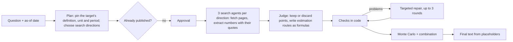

# Verrier

**Estimates official numbers before they are published, from public data. The model proposes the reasoning; Python computes every number; every input traces back to a quoted source.**

Ask *"How many babies were born in South Korea in July 2026?"* a month before the statistics office publishes the figure. Verrier pins down exactly what is being asked, sends search agents out in several directions, and extracts each number together with its unit, period and the sentence it came from. A judge model then writes independent estimation routes as formulas over those numbers. Code checks every route, runs it, and combines the routes into an estimate with an 80% interval. The final text is written around placeholders that code fills in, so every number in the answer comes from the computation.

Named after Urbain Le Verrier, who in 1846 worked out where Neptune had to be before anyone had seen it.

## Example

```sh
python -m triangulate agent --question fc_kr_births_2026_07 --auto-approve
```

The run stands on 2026-08-23. Statistics Korea published the figure on 2026-09-23. Output, from a real run on v2.16e (`results/agent/fc_kr_births_2026_07/v216_reg/`):

```text
The best computed estimate for live births occurring in South Korea during July 2026, as first published in
Statistics Korea's monthly Population Trends release, is 24,625 person (80% model-based interval 17,875 to
33,925 person).

Evidence: the observed anchor is July 2025 births of 21,803 live births. Two YoY-scaling routes apply growth
factors of 1.12 (range 1.006 to 1.257) and 1.13 (range 1.015 to 1.269), giving 24,518 person and 24,733 person.
Both factors are analyst assumptions, not observations, and both routes share the same KOSTAT monthly source,
so they are not independent. ...

Method details (computed by code):
- m1 formula_mc: p16 * a1; Monte Carlo P10 to P90 19,811 to 30,446; result unit (person/month) * 1 month
  converted to person; own 80% width x/÷1.38 (no error evidence, code's default width)
```

Official figure: **24,275**. Error **+1.4%**, inside the interval.

Every run leaves a complete record in `results/agent/<id>/<tag>/`:

| file | what it holds |
|---|---|
| `ledger.md` | every data point: value, unit, period, source URL, the quoted sentence, and whether the judge kept it and why |
| `graph.html` | the computation as an interactive graph, from sources to the estimate |
| `state.json` | the full run state: plan, every judge round, every repair and check, the Monte Carlo result |
| `calls.jsonl` | every model call, with tokens and cost |

## Results

The held-out test was pre-registered before any model call (tag `test1-prereg`). The code was frozen at `v2.1c` and the test used three official monthly figures released after the model's training cutoff:

| | Taiwan births, Sep 2026 | Heathrow passengers, Sep 2026 | Japan births, Jul 2026 | median abs. error |
|---|---|---|---|---|
| **Verrier** | +1.1% | +3.0% | +0.8% | **1.1%** |
| Model answers directly, no web | +42.8% | +0.3% | +4.0% | 4.0% |
| Model writes a structured estimate, no web | no answer | −2.5% | −2.4% | 2.4% |

All three official values fell inside Verrier's 80% interval. The scores are in `results/agent/summary_test1.json`.

Later backtests and the fixed regressions run for new versions are pre-registered the same way. Plans, scoring scripts and scores are in `EVAL_*.md`, `results/experiments/` and `results/agent/summary_*.json`.

## How it works



What code does, so the model doesn't have to be trusted:

- **Every number is computed.** Formulas are evaluated by a whitelist parser (no `eval`). Units are converted with a unit library, including per-period rates converted to totals. Intervals come from Monte Carlo sampling of each input's range.
- **Every input is checked against its source.** The extracted number is re-read from the quoted sentence. Three checker calls and an arbiter review the unit of each route's result. An input audit asks whether each input measures what the formula needs.
- **Order-of-magnitude gate.** The combined estimate is compared with an independent rough estimate. If it is more than 2× off, the routes go back once with the exact way code read each input.
- **Repairs fix, they don't delete.** A repair may only change what an error names. Removing a route requires naming the wrong input and the evidence.
- **Honest combination.** Routes that share most of their inputs count as one block, and blocks get equal weight. The interval widens when blocks disagree by more than their own widths.
- **No peeking in backtests.** Pages are fetched as they stood on the as-of date (Wayback snapshots). A leak sentinel catches the registered official value if it shows up anyway.

## Quick start

Tested on Python 3.14.

```sh
git clone https://github.com/Dannytao2004/verrier.git
cd verrier
python -m venv .venv
.venv/Scripts/activate          # macOS / Linux: source .venv/bin/activate
pip install -r requirements.txt
```

Put your DeepSeek key in a file as `DEEPSEEK_API_KEY=sk-...`. By default this is `./.env`; set `TRIANGULATE_KEY_FILE` to use another path. The key is read from that file only and never written into results.

Ask any question about a number that hasn't been published:

```sh
python -m triangulate agent --ask "How many passengers will Heathrow handle in December 2026?" --as-of 2026-11-25
```

The command line shows the plan and waits for your approval. At DeepSeek off-peak prices a run uses about $0.2–0.5 of tokens, plus web-search fees.

You can also use the local web UI:

```sh
python -m triangulate serve        # http://127.0.0.1:8770/verrier
```

The web UI takes your own key for DeepSeek, Claude, GPT, Kimi or GLM (`PROVIDERS.md`). The key stays in memory for that run only.

Tests run offline, with no network and no key:

```sh
python -m unittest discover -s tests
```

## Repository layout

| path | content |
|---|---|
| `triangulate/agent/` | the agent: LangGraph pipeline (`graph.py`), prompts, search and fetch, value check, unit review, input audit, magnitude gate, method library and compute |
| `triangulate/` | shared core: expression evaluator, units, Monte Carlo, model client and provider adapters, baseline arms |
| `triangulate/web/` | local web UI |
| `probes/` | experiment, replay and regression scripts |
| `results/` | every saved run and score |
| `tests/` | unit and integration tests (offline) |
| `NEXT.md`, `BUGS.md` | development log and issue tracker |
| `EVAL_*.md`, `FORECAST.md` | pre-registered evaluation plans and question-selection rules |

## Data

The realFP benchmark comes from allenai/fermi, which has no license file, so its question text and answers are kept out of git (`DATA.md`). Only question ids and metrics are committed. Saved runs include short quotes from the web pages they cite, with links to the source or its Wayback snapshot.

## License

No license is granted yet; all rights reserved. The files `triangulate/web/static/verrier_halo*` derive from HALOFLUX and stay under the PolyForm Noncommercial License (`triangulate/web/static/haloflux_LICENSE.txt`).
